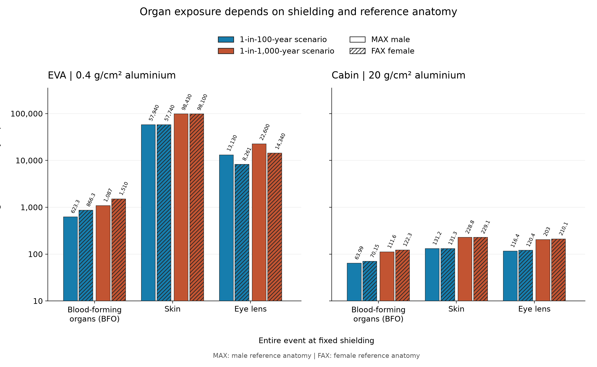
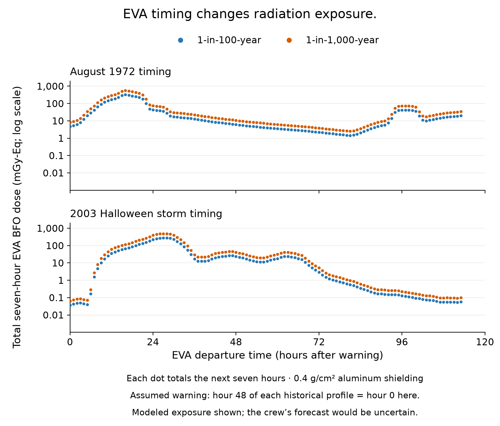
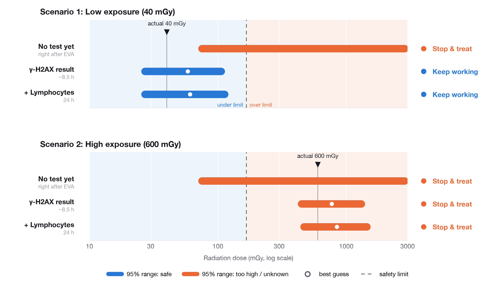
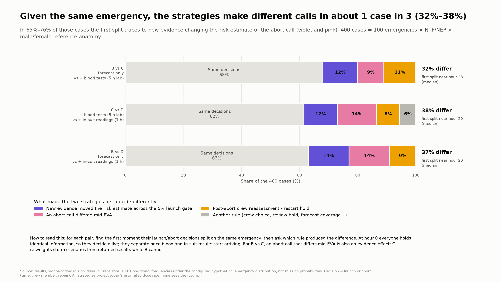
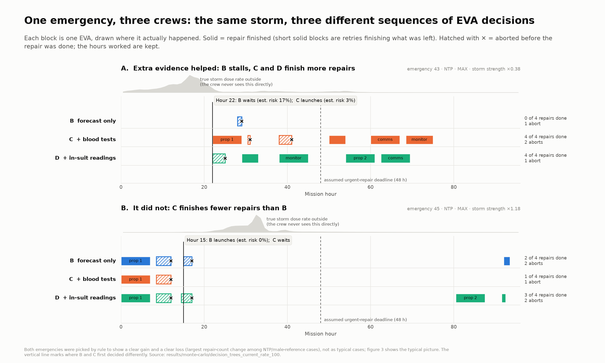
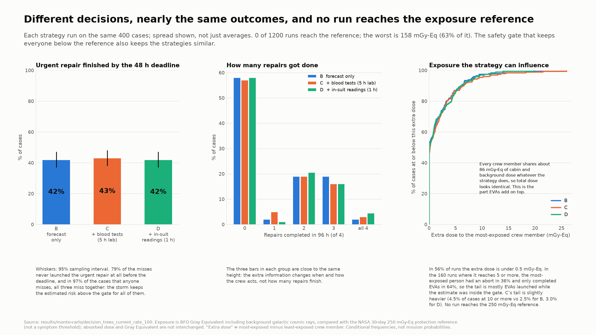
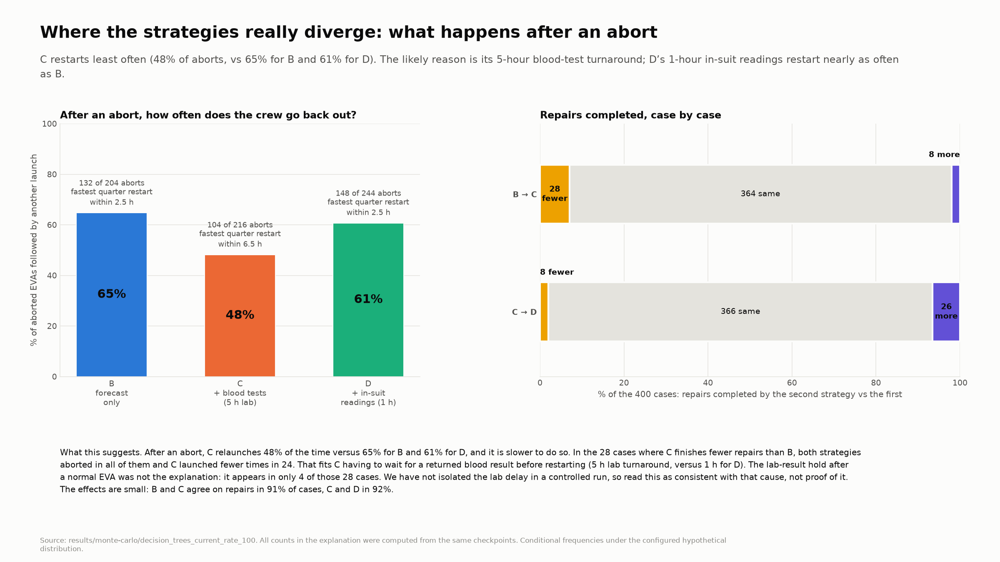

# CNL Mars 2040: Team 21 simulator

Western University, Team 21, for the Fall 2026 CNL Case Competition (*Nuclear Emergency During a Mars Mission*).

**The question:** a crew has to repair its ship outside, during a solar storm, next to a reactor. How should it
decide when to go out, and does better radiation information change those decisions?

## The short version

- There are two ships: **NTP** (nuclear thermal) and **NEP** (nuclear electric). Each has its own repair priorities and hazards.
- There are four strategies, and each adds information to the one before:
  - **A** repairs immediately after stabilizing the ship, with only a generic storm warning. It is not in the Monte Carlo.
  - **B** uses a forecast-based estimate of the current dose rate to time EVAs and call aborts.
  - **C** adds blood tests (γ-H2AX and lymphocytes) that feed a Bayesian dose estimator.
  - **D** adds a hypothetical 2040 in-suit panel (four radiation-responsive genes, plus foci and FDXR) that can trigger an abort mid-EVA.
- Doses come from SAPPHIRE storm spectra, NASA OLTARIS organ transport and historical storm timing (1972 and 2003).
- All strategies see the same storm, damage and crew. Only what they can observe differs.

## What the charts show

**Storm timing.** The 1972 and 2003 storms are normalized so each sums to 100%. The chart shows when dose
happens, not how big the storm is.

**Dose sources.** The storm spectra, shielding and organ dose chain.

**Timing matters for EVAs.** Blood-forming-organ dose from a seven-hour EVA, starting at each hour of the 1972 profile.

**Forecast for B.** The shading shows how the forecast spreads when storm timing and strength are uncertain.

**Start selection for B.** Exposure for each possible EVA start.

**Biodosimetry estimator for C.** The dose range narrows once blood results arrive.

**Anatomical EVA exposure.** Organ dose for the EVA shielding cases.

**Spectrum fit check.** The corrected Band fit against the source spectra.

## Monte Carlo: do different information sources change the decisions?

The run has 100 matched emergencies, each on NTP and NEP and on two reference anatomies, so 400 cases per strategy,
evaluated over 96 h. B, C and D face the identical storm, damage and crew, and each projects today's estimated dose
rate. None of them sees the future. Setup and settings are in
[`results/presentation/decision_trees/README.md`](results/presentation/decision_trees/README.md).

**1. The decisions differ.** B, C and D choose different EVA launches or aborts in 32 to 38% of cases. About two
thirds of the first splits come from new evidence moving the estimated risk across the 5% gate, or from in-EVA
readings.

**2. One emergency, three crews.** The same storm produces three different EVA sequences. We picked the two cases
by rule to show a gain and a loss, so they are not typical.

**3. Outcomes barely change.** The urgent repair finishes on time in 42% of cases for B, 43% for C and 42% for D.
All four repairs finish in 2%, 3% and 4%. The median worst-organ BFO dose is about 89 mGy-Eq for all three, and no
run reaches the 250 mGy-Eq reference. Better information changes the decisions here, but it does not change the
repairs completed or the dose received.

**4. After an abort.** C goes back out least often after an aborted EVA: 48% of its aborts are followed by another
launch, against 65% for B and 61% for D. That fits C's 5 h lab turnaround, but we did not isolate the cause.

Full tables are in [`provenance/RESULTS.md`](results/presentation/decision_trees/provenance/RESULTS.md) and
[`provenance/DECISIONS.md`](results/presentation/decision_trees/provenance/DECISIONS.md). They are conditional
frequencies under hypothetical team assumptions and are not mission probabilities.

The presentation deck is [`results/presentation/CNL_Team21_Presentation.pptx`](results/presentation/CNL_Team21_Presentation.pptx),
and the final-case figures have a gallery at [`results/final-case/index.html`](results/final-case/index.html).

## Limitations of the simulator

**The storm is a scenario.**
- Timing comes from two historical profiles (1972 and 2003) scaled to SAPPHIRE totals. Strength is drawn from a
  range we chose (0.35 to 1.25 times the 1,000-year spectrum), and spectral hardness is fixed.
- The forecast is a library of 18 scenarios with equal prior weights. Those weights are not calibrated, so the
  forecast's accuracy is an assumption.

**The decision rules are our own design.**
- The 48 h repair deadline, the 7 h EVA, the 0.5 h return, the 2 h restart review and the 5% launch gate are
  assumptions, not CNL requirements.
- Keeping the hours worked after an abort is an assumption. Setting it to zero makes repairs all-or-nothing and
  hurts the strategies that abort more.
- The 5% gate is conservative. In hindsight, many emergencies had a feasible window that the strategies did not use,
  and the gate keeps every run far below the exposure reference, which also keeps the three strategies similar. We
  did not test a looser gate.
- No strategy sees the future. One that did would likely do better, and we left that out on purpose.

**The biology is exploratory.**
- The marker models come from lab gamma-irradiated blood, not solar protons. Noise levels, the 53BP1 and FDXR
  calibrations and the 5 h and 1 h assay delays are assumptions.
- Strategy D's in-suit panel is hypothetical hardware. The results say nothing about whether it can be built.
- The simulator does not predict symptoms or health outcomes. The 250, 1,500 and 1,000 mGy-Eq references are
  planning limits, not symptom thresholds.

**The physics and the spacecraft are simplified.**
- The anatomies are male (MAX) and female (FAX) reference phantoms, run as separate crews, never mixed. The 0.4 and
  20 g/cm² aluminium shields are stand-ins for a suit and a cabin, not real geometry.
- Reactor dose is not calculated. Task access (every NTP worksite cleared, every NEP route protected) is assumed.
- Galactic cosmic radiation is a constant, and the EVA value uses a 5 g/cm² proxy from a 2011 table.
- Waiting does not damage the spacecraft, and exposure before the emergency starts is excluded.

**How far to trust the numbers.**
- Every frequency is conditional on the assumptions above. The confidence intervals measure sampling noise across
  100 emergencies and nothing else.
- Results here were run once with seed 21. Neighboring cases share each emergency, so the 400 cases are not 400
  independent samples.

## Where things are

| Folder | Contents |
| --- | --- |
| `sim/` | Mission engine, strategies and runners |
| `radiation/` | Storm spectra, organ-dose transport and data preparation |
| `bayes_estimator/` | Biodosimetry estimator for Strategies C and D |
| `charts/` | Plotting scripts and the gallery builder |
| `cad/` | SolidWorks CAD for the in-suit sensing hardware (`Assem2`: patch and hub parts, assembly and drawing) |
| `configs/` | Monte Carlo experiment settings |
| `docs/` | Method notes |
| `data/` | Source records and processed tables |
| `results/` | Figures, the deck, and selected Monte Carlo and mission outputs |

Method details are in [`docs/`](docs/), starting with [`docs/mission_recovery.md`](docs/mission_recovery.md) and
[`docs/monte_carlo.md`](docs/monte_carlo.md). Source data is in [`data/raw/`](data/raw/).
