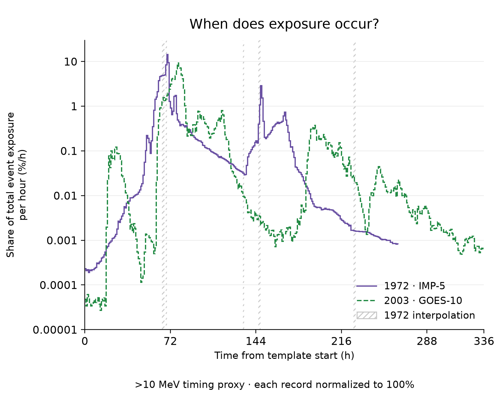
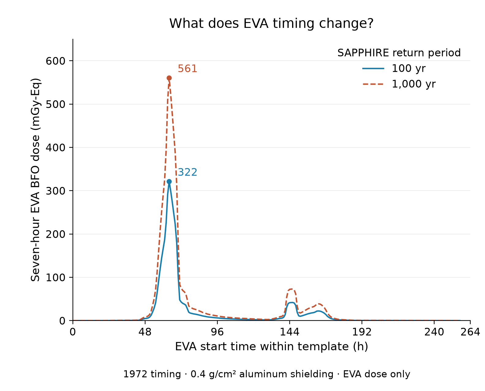
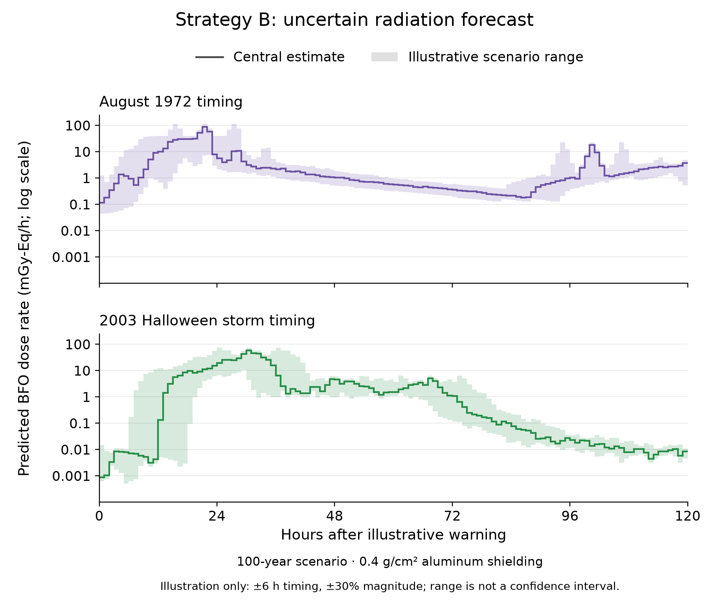
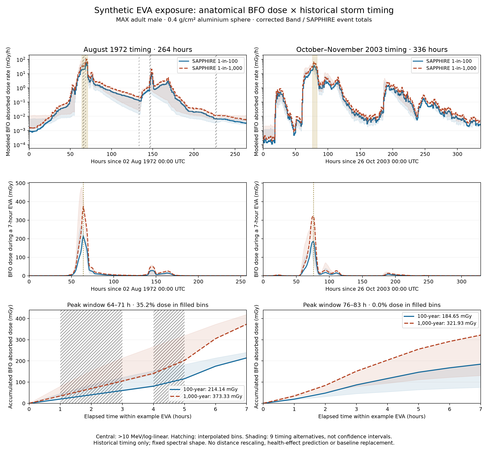
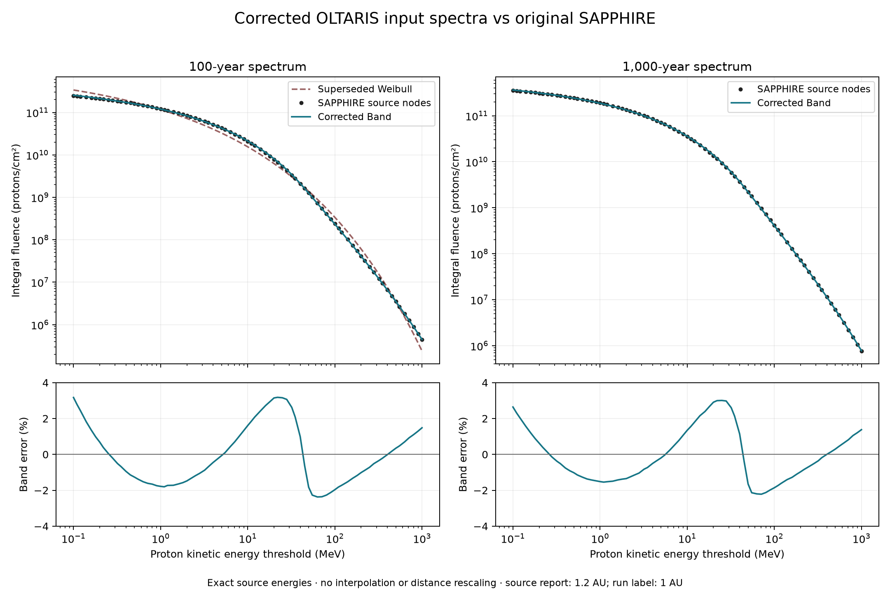
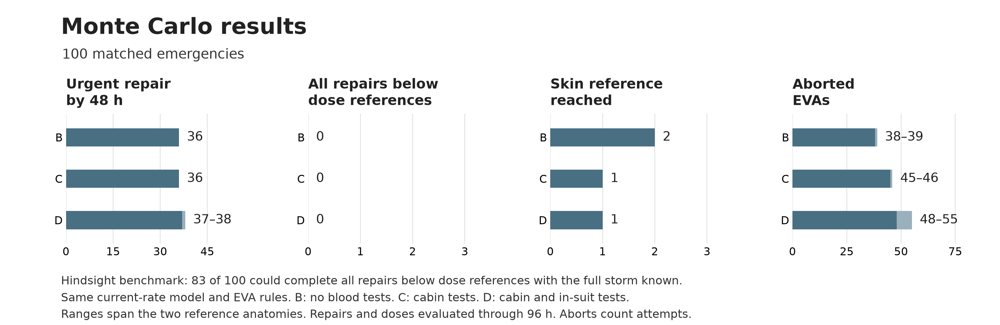

# CNL Mars 2040 — Team 21 simulator

Western University, Team 21, for the Fall 2026 CNL Case Competition (*Nuclear Emergency During a Mars Mission*).

**The question:** a crew has to repair its ship outside, during a solar storm, next to a reactor. How
should it decide when to go out, and does better radiation information change those decisions?

## The short version

- Two ships: **NTP** (nuclear thermal) and **NEP** (nuclear electric). Each has different repair priorities and hazards.
- Four strategies, each adding information to the one before:
  - **A** — immediate repair after stabilizing the ship. Only a generic storm warning. *Not in the Monte Carlo.*
  - **B** — forecast-informed EVA timing.
  - **C** — forecast plus blood tests (γ-H2AX and lymphocytes) feeding a Bayesian dose estimator.
  - **D** — forecast plus a hypothetical 2040 in-suit panel (four radiation-responsive genes, plus foci and FDXR).
- Doses come from SAPPHIRE storm spectra, NASA OLTARIS organ transport, and historical storm timing (1972 and 2003).
- All strategies see the same storm, damage and crew. Only what they are allowed to observe differs.

## What the charts show

**Storm timing.** The 1972 and 2003 storms are normalized so each sums to 100%. This shows *when* dose
happens, not how big the storm is.


**Dose sources.** The storm spectra, shielding and organ dose chain.


**Timing matters for EVAs.** Blood-forming-organ dose from a seven-hour EVA, starting at each hour of the 1972 profile.


**Forecast for B.** Shading shows how the forecast spreads when storm timing and strength are uncertain.


**Start selection for B.** Exposure for each possible EVA start.


**Biodosimetry estimator for C.** The dose range narrows once blood results arrive.


**Anatomical EVA exposure.** Organ dose comparison for the EVA shielding cases.


**Spectrum fit check.** The corrected Band fit against the source spectra.


**Monte Carlo results** (100 matched emergencies, both ships, both reference anatomies, evaluated through 96 h):


What it says:
- Urgent repair by 48 h: B 36, C 36, D 37–38 of 100.
- All repairs below the dose references: 0 for every strategy. With the full storm known in hindsight, 83 of 100 could have.
- Skin reference reached: B 2, C 1, D 1.
- Aborted EVAs: B 38–39, C 45–46, D 48–55. In-suit readings let D pull crew back more often, which also costs repairs.

Two matched examples (draw 42 and draw 86) are in [`07_monte_carlo_two_matched_examples.png`](results/presentation/final_results/07_monte_carlo_two_matched_examples.png).

**Gallery of final-case figures:** [`results/final-case/index.html`](results/final-case/index.html).

## Honest limits

- The storm is a **scenario**, not a forecast. Timing comes from historical profiles scaled to SAPPHIRE totals.
- Repair deadlines, hold durations and EVA schedules are **our assumptions**, swept in sensitivity runs.
- The biomarker models are **exploratory**. They are calibrated on lab gamma-irradiated blood, not solar protons. The in-suit panel (D) is hypothetical.
- The anatomy is a male reference phantom. The 0.4 and 20 g/cm² shields are surrogates, not spacesuit or spacecraft geometry.
- The simulator does not predict symptoms or health outcomes.

## Where things are

| Folder | Contents |
| --- | --- |
| `sim/` | Mission engine, strategies and runners |
| `radiation/` | Storm spectra, organ-dose transport and data preparation |
| `bayes_estimator/` | Biodosimetry estimator for Strategy C and D |
| `charts/` | Plotting scripts and the gallery builder |
| `configs/` | Monte Carlo experiment settings |
| `docs/` | Method notes |
| `data/` | Source records and processed tables |
| `results/` | Figures, deck, and selected Monte Carlo and mission outputs |

## Running it

Python 3.12.

```bash
python3.12 -m venv .venv
.venv/bin/pip install -r requirements.txt

# one mission, recovery constraints on
.venv/bin/python -B -m sim.run_strategy_a --recovery

# strategy comparison for one ship
.venv/bin/python -B -m sim.run_comparison --engine NTP --output-dir results/comparison_ntp

# Monte Carlo (2003 timing, 1-in-1,000 storm)
.venv/bin/python -m sim.run_monte_carlo --config configs/monte_carlo_2003_1000.json --workers 4 --output-dir results/monte-carlo/my_run

# charts
.venv/bin/python -B charts/09_anatomical_eva_exposure.py
.venv/bin/python -B charts/build_final_case.py
```

Method details are in [`docs/`](docs/), starting with [`docs/mission_recovery.md`](docs/mission_recovery.md). Source data is in [`data/raw/`](data/raw/).
