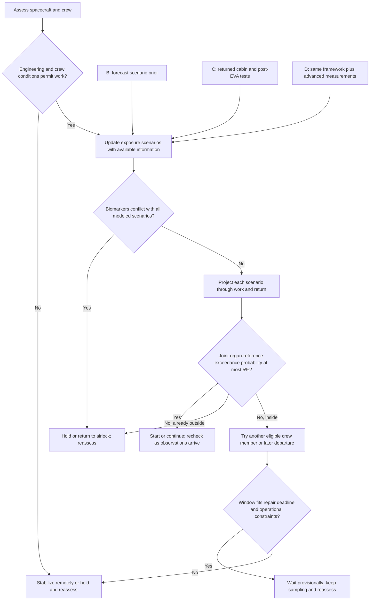

# Forecast-informed and biological EVA decisions

## Purpose and boundaries

One simulator advances all strategies through the same emergency. The experiment asks whether
different information changes repair timing, crew choice and exposure, not whether D can be made
to win. NTP/NEP share solar radiation physics. Existing engineering gates and different repair
priorities remain; hard repair deadlines are disabled by default. Without a separately specified
deterioration model, waiting does not progressively damage the spacecraft. Report that boundary
when interpreting delayed-repair results; no mission-success rate or clinical benefit is established.

The model supports one astronaut per EVA, sequential repairs, explicit return travel after completion or abort,
zero initial exposure, and a mission interval of at most 30 days. Initial nonzero doses are rejected
for informed runs because their exposure history and blood/skin/lens priors are not supplied.
A constant published-reference GCR component is added during the emergency in both cabin and EVA.
See `docs/background_radiation.md` for the EVA proxy and source conditions. Reactor dose and prior
cruise exposure remain excluded.

## Code map

| File | Responsibility |
| --- | --- |
| `sim/informed_config.py` | Explicit forecast, reference, cadence and noise settings |
| `sim/radiation_information.py` | Forecast integration, sample/result scheduling, immutable policy observations |
| `bayes_estimator/longitudinal.py` | History-dependent signals and shared C/D Bayesian likelihood |
| `sim/strategies.py` | Common safety gates with distinct crew selection and departure rules |
| `sim/mission_simulator.py` | Existing authoritative mission clock and physical exposure accounting |
| `sim/run_comparison.py` | Paired B–D runs and auditable output files |

## Decision rule

1. Honor stabilization, worksite clearance, consent, skills, repair prerequisites and operational restrictions.
2. For the highest-priority feasible repair, project each eligible astronaut's accumulated exposure through
   their return. B takes the first acceptable crew member in rotation order. B only estimates current dose rates
   from the configured uncertain storm profiles. It checks launch and continuation assuming those current rates
   persist through return, then recalculates when the mission clock advances. This is a persistence assumption
   applied to an imperfect estimate, rather than a direct radiation measurement. C ranks acceptable crew
   by the highest upper dose across organs, expressed as a fraction of each organ's own reference.
   D ranks using the larger of the biological estimate and the forecast estimate. Rotation breaks ties.
   For C and D, both the unadjusted forecast and the biological estimate must clear the launch gate.
3. D may wait up to four hours on a nonurgent task if the estimated dose score drops by more than 20%
   and the remaining work fits before the cutoff assuming no further waits. This optional target
   can move earlier but cannot move later. It is an experimental scheduling assumption.
   C and D search hourly departures over the next 24 hours when no acceptable EVA can start now,
   including cabin exposure during the wait. B waits for a new current-rate assessment and does not pick a
   future departure from the simulated storm profile.
   Respect known operational restrictions and any explicitly enabled recovery deadline. A candidate is
   provisional: wait and recompute on the next observation, rather than commit to a perfect-future schedule.
4. With no acceptable candidate, shelter/wait and flag recovery reassessment in the decision log. A lack
   of a candidate inside the search horizon is not proof that no later candidate exists. No threshold override
   is allowed. Insufficient remaining forecast coverage requests temporary shelter and reassessment.
5. During EVA, reevaluate accumulated plus remaining planned exposure. Abort when the criterion fails,
   measurements conflict with the forecast hypotheses, or the remaining EVA cannot be forecast.
6. Completed repairs alone do not authorize mission continuation: engineering and current crew exposure
   assessments must also permit it. A hold or abandoned objective is not a prediction of crew death.

## Forecast and quantities

`configs/monte_carlo_matched_current_rate.json` compares the value of the
biological observations under a common policy. B, C and D all estimate the current
dose rate, assume it persists through the EVA and return, and assess departure now.
They share crew rotation, organ references, launch and abort criteria, and a hold
on any task stopped for a radiation abort. The matched experiment uses no optional
dose-saving waits or mandatory test-specific holds. Returned biological results can
change the estimates used at the same decision gates. B receives no biological
measurements, C receives conventional cabin and post-EVA tests, and D adds its
modeled in-suit measurements and faster foci processing.

`configs/monte_carlo_matched_restart.json` changes the post-abort rule for all
three strategies. After the astronaut returns, the common forecast must indicate
two hours of lower upper-bound exposure than at the abort. Throughout that
interval, the forecast-only risk of exceeding any organ reference from a fresh
EVA must be within the 2.5% restart tolerance. The actual launch must also pass
the forecast-only and evidence-adjusted cumulative dose checks for the selected
astronaut. A crew swap or a favorable lab result alone cannot reopen the task.
The two-hour requirement is a modeled operating assumption. The forecast may
still be wrong, and each interrupted task still requires a full new attempt.

The mixed-storm experiment in `configs/monte_carlo_bcd_biomarker_decisions.json`
uses the revised trees. It spans the configured forecast-strength error range and
adds a 5% stress tail at three times the largest in-range strength correction.
B uses the forecast prior. In C and D, the crew combines compatible returned readings
to update the shared storm probabilities, then separately projects the dose of each
candidate astronaut. Individual dose, review holds, qualifications and rest stay
with the astronaut. The model assumes assay errors are independent across people
conditional on the storm member and accounts for correlated markers within each person.

The resulting organ-reference risk drives launch in all three strategies. In the
revised experiment, C/D can clear a forecast-only hold when returned evidence supports
the departure and continue to stop for conflicting evidence or an excessive estimate.
The older experiment configuration retains its forecast-only launch veto. Both
configurations preserve the 5% criterion and the stricter restart margin. The
revised prior and shared likelihood are experimental choices to test, including
cases where changes in evidence lead to an abort or prevent repair.

`ForecastSpec` is independent of the true `Scenario`. Its default is a 100-year August-1972-shaped
nominal forecast, origin at profile hour 48, with timing shifts −6/0/+6 hours and magnitude multipliers
0.7/1/1.3. Nine coherent histories receive equal **experimental prior weights**, not calibrated forecast
probabilities. No measured forecasting performance is asserted. The nominal forecast is fixed during a
run; successive decisions reevaluate it but do not receive an oracle update from the true storm.

The runner explicitly selects a nominal template and accepts independent forecast severity, template,
and origin overrides. Matching nominal and true templates is an idealized reference experiment, not a
historical forecast reconstruction. Check bias and out-of-support storms before interpreting benefits.
No extrapolated zero-dose tail is used beyond forecast data coverage.

Each forecast history carries absorbed BFO mGy and original OLTARIS BFO/skin/lens mGy-Eq, integrated
using the same normalized timing assumption as the existing environment. Each member is one
coherent past-and-future exposure scenario. B retains the equal scenario prior; C/D update scenario
weights using returned biological measurements. The same weights apply to the member's transported
organ doses and its future trajectory. This assumes that evidence about earlier exposure helps distinguish
persistent storm shape/strength hypotheses. It is NOT a direct blood-to-skin conversion, an instant
storm-peak detector, or a validated ability to predict future spectral evolution. A wrong or incomplete
scenario library can still produce confidently wrong decisions.

The shared gate computes the weighted probability that **any** BFO, skin or lens reference is reached
by the end of the proposed EVA, including prior dose, waiting and return travel. Launch/continue requires
that probability to be at most 5% (the existing 95% policy setting). This is a joint scenario-risk criterion,
not three independent marginal 95% checks. The organ references remain 250/1,500/1,000 mGy-Eq.
Equality counts as an exceedance within each member. Marginal upper estimates remain logged for
interpretation, but the joint probability drives the decision. This is conditional model probability,
not clinically calibrated safety or NASA compliance. Gross biomarker conflict still forces a hold/abort.

Biological likelihoods use absorbed BFO mGy only. Scenario transport retains the original organ-specific
Gray Equivalents; there is no universal `mGy × 1.5` conversion. No reference or noise coefficient was
relaxed to favor C or D. A is excluded from the comparison runners; its old standalone implementation
remains available for legacy tests, not as a validated health-first comparator.

## Collection and biological timing

C and D use the same estimator with different collection schedules and operational rules.
Sampling rules below are explicit experiment choices, not facts specified by CNL. Both C and D
receive the same six-hour cabin panel (H2AX and lymphocytes), beginning with a baseline at hour zero.
This permits learning while sheltered before any EVA. Six-hour cadence, onboard capacity and the
default zero sampling burden are assumptions, not demonstrated instrument capability.

| Measurement | C collection | Additional D collection | Response used |
| --- | --- | --- | --- |
| γ-H2AX | Every 6 h in cabin and 0.5 h after return; result after 5 h | Before departure, hourly while working outside and after return, with 1 h processing | Early foci response, with 0.5–8 h decay |
| Lymphocytes | Every 6 h in cabin and 12/24/48 h after return; 0.1 h processing | Same follow-ups and 0.1 h processing | 12–48 h response |
| 53BP1 | None | Before departure, hourly while working outside and 0.5 h after return, with 1 h processing | 0.5–2 h early response |
| AEN | None | Hourly while outside | 2–8 h |
| TRAF4 | None | Hourly while outside | 4–8 h |
| DDB2 | None | Hourly while outside | 4–8 h, retained through 24 h |
| TRIAP1 | None | Hourly while outside | 8–24 h |
| FDXR | None | Hourly inside from mission hour 24 | 24–48 h illustrative response |

After an EVA, C and D hold that astronaut from another EVA until a γ-H2AX result collected
after return is available. A result that leaves current exposure risk above the configured
criterion, or conflicts with the modeled scenarios, keeps the individual under review.
Other cleared astronauts may still work, subject to the shared restart rules after a radiation abort.

In C, a radiation abort also suspends the repair for everyone until independent
radiation clearance is available. A new astronaut or a returned blood test alone
cannot release the repair. The current model provides no new independent clearance,
so the repair stays suspended for that emergency. Other tasks may proceed if they
pass the shared restart and engineering checks. A suspended urgent prerequisite
blocks the urgent chain, and the mission can miss its deadline.

During D's EVA, each returned in-suit result enters the exposure estimate at its result time.
D checks estimated exposure through an immediate return and through planned completion plus
return. It orders an early return if the assessment fails either check. In-EVA measurement
collection can be disabled through `in_eva_monitoring` to isolate its effect in paired experiments.
The proposed device and its assay timing are simulated. Biology updates the estimate of exposure
already received, while the forecast scenarios supply the projection through work and return.

The response clock belongs to **each earlier exposure interval**, not the EVA start or result arrival.
Every marker integrates its age-response kernel against the full cabin/EVA dose history. This allows
TRIAP1 during a seven-hour EVA to inform older exposure, without pretending it detects brand-new
irradiation instantly. Integration of piecewise-linear kernels is invariant to subdividing a constant
dose-rate interval. Late samples can retain information after an EVA; the inference uses sample time,
never result time, for biological response.

Onboard follow-ups due while outside are deferred until return; their actual collection time is recorded.
Available pre-departure D results are incorporated before authorizing the launch; a changed estimate
can change the crew selection or postpone departure.
Lymphocyte processing takes 0.1 h in both C and D, separate from the unchanged 12/24/48 h
post-return collection schedule and biological response. C's γ-H2AX processing remains 5 h.
D's γ-H2AX and 53BP1 processing takes 1 h, an explicitly assumed automated 2040 imaging
turnaround. These choices follow the user-supplied `biomarker_parameters_all_sources.numbers`
(lymphocyte processing entry citing Li 2022 Table 5; automated imaging entry labelled assumption).
They are configurable through `lymphocyte_processing_delay_h` and `automated_foci_delay_h`;
explicit `instrument_delays_h` overrides take precedence. Other D markers retain zero unspecified
processing delay in this idealized experiment. Biological delays remain in all cases.
Result-availability times are simulation boundaries, so a six-minute processing interval does not
have to wait for the next hourly decision step.
A pre-departure sample with a pending result does not inform that departure or itself force a hold.
One-hour sampling is a numerical approximation to the proposed continuous in-suit system, not an
assertion that a real instrument samples instantaneously. Configurable sampling burden delays cabin
availability or pauses repair work while outside exposure continues. Unavailable measurements are
logged without inventing readings. See `operational_realism.md` for instrument stress cases and
fixed-period follow-up. Pending results can arrive during temporary holds and declared shelter follow-up;
results beyond the stated observation end remain pending.

## Calibration and noise provenance

The user's slides supply AEN/TRAF4/DDB2/TRIAP1 response windows and 2-Gy time-point anchors, citing
Li et al., *Life* 2022;12:99. The code uses fold-change **above baseline divided by 2 Gy**, with explicitly
exploratory interpolation in time and linear superposition in absorbed dose. This is not a demonstrated
low-dose SPE-proton calibration or a validated chronic-exposure model. Kernel values at uncovered
times, the AEN early point, and DDB2/TRIAP1 late points are slide-plot approximations.

γ-H2AX uses the existing module's approximately 11 foci/Gy and five-hour decay scale, associated with
the slide's Ivashkevich et al. 2011 reference. 53BP1 temporarily uses the same early foci scale as an
explicit surrogate, not an independently fitted calibration. Lymphocyte depletion coefficients remain
exploratory. FDXR has a deliberately labelled illustrative 1-unit/Gy sensitivity and 24–48 h window;
the slide provides a next-day signal, not a full fitted dose/time curve. FDXR and 53BP1 therefore require
sensitivity testing or replacement calibration before any quantitative claim about D's benefit.

Additional assumptions:

- BFO absorbed exposure is a proxy for the sampled blood response; anatomical/nonuniform exposure,
  mixed radiation, interindividual biology and calibration transfer are not resolved by this model.
- Positive signals have log-normal noise: group log-SD 0.20, individual-marker log-SD 0.20,
  reading log-SD 0.15. These values are experimental, not source-derived performance estimates.
- A shared group offset and individual-marker offsets persist for an astronaut. Gene/foci correlations
  are included in the joint likelihood. Named, seeded draws reproduce common measurements across
  strategies rather than making noise depend on how many other assays were requested.
- Only the latest returned sample per marker enters the likelihood. The posterior is recomputed from
  the prior; repeated observations are not multiplied as independent evidence. This conservative
  simplification avoids false precision but discards some longitudinal information.
- Grossly incompatible results (minimum normalized Mahalanobis distance beyond the configured
  three-SD criterion) retain the broad prior and flag a hold/abort assessment. The finite ensemble
  cannot estimate an arbitrary dose outside its hypothesis support; matching kernels in generation
  and inference are an idealized experiment, not external validation.
- Skin/lens checks can dominate this light-shielding scenario. Similar B/C/D decisions are a legitimate
  result. No policy or calibration is adjusted just to force a D advantage.

Source context: https://www.mdpi.com/2075-1729/12/1/99 and the repository's
`bayes_estimator/markers.py`, user-supplied slides, OLTARIS summaries, and archived standard:
https://www.nasa.gov/wp-content/uploads/2023/11/nasa-std-3001-vol-1-rev-c-with-signature.pdf

## Checks and use

Run `python -B -m sim.run_comparison` from the repository virtual environment. Separate output folders
preserve distinct experiments; the existing write-preservation helper archives changed in-repository outputs.
The runner exports true outcomes for evaluation separately from policy estimates and measurement
logs. `received_h` records when a result enters the decision system; pending samples expose no values
to policies. Operational observations are immutable and contain no true dose, environment or crew objects.

The NEP access gate is preserved: without an explicitly confirmed protected route/worksite or approved
alternative, all policies request a hold. `--nep-protected-access` enables the protected-access scenario
for comparison; it is a scenario assertion, never something inferred from the SPE forecast.

Tests cover policy gates, cabin accumulation while waiting, finite forecast coverage, response onset,
older-exposure signals, interval integration, duplicate evidence, conflicting measurements, lab delay,
in-EVA sampling, fixed-forecast independence from hidden severity, repeatability and dose conservation.
Passing these tests verifies software behavior, not medical or biological validity.

## Executable decision flow after the B–D revision

The diagram summarizes `strategies.py` and `radiation_information.py`; it is not a
separate policy implementation. Reference risk is calculated jointly across organs
under the modeled scenarios. It is not the probability of death or illness. A hard
engineering deadline can end the recovery attempt; it never automatically relaxes
exposure gates. Cabin sampling does not create new information before a marker's
response and processing delays permit it. No first-EVA requirement remains for C.

## Crew reassessment after radiation abort (18 November revision)

A radiation-related abort now registers the affected astronaut as a witness for a
crew-wide restart review. Swapping to a lower-dose astronaut does not erase that
witness's evidence about the shared storm. No true dose or physical environment is
used for this review.

- Wait for the astronaut to return. C/D additionally require a returned post-return
  H2AX sample. A fast lymphocyte result cannot clear this review while H2AX is pending. Its usual biological and processing delays remain.
- Unresolved conflict between any abort witness's biological evidence and the modeled
  scenarios blocks all subsequent EVAs. New results can resolve the conflict.
- For a candidate EVA, evaluate the candidate's own accumulated and projected exposure
  using both their own scenario weights and each abort witness's scenario weights.
  Take the largest modeled exceedance probability. Do not transfer the witness's
  personal accumulated dose to another astronaut and do not multiply correlated
  crew likelihoods as independent evidence.
- Restart requires risk at most 2.5%, half the normal 5% tolerance. After departure,
  continuation retains the normal 5% criterion. This explicit hysteresis assumption
  reduces launch/abort cycling near the boundary; it is not a new medical limit.
- Witness assessments persist for the remaining emergency and update as results arrive.
  A personal cumulative-dose problem may permit a lower-dose replacement; a shared
  unresolved forecast problem does not. B has no biological-result prerequisite but
  retains its forecast-based restart check.

`restart_risk_fraction` controls the operational margin. Its default 0.5 and the
post-return review protocol require sensitivity testing. In the two detected failure
cases, D's five aborts became one, and C's three urgent-task aborts became one, without
changing organ references, physics, deadlines or biomarker calibration. This does not
establish universal recovery improvement.

Repairs remain atomic seven-hour tasks in this version: aborted work does not count
as completed progress. That limitation particularly affects strategies with more
aborts and must accompany performance claims. Partial-progress preservation requires
separate task-specific assumptions; it was not silently added during this repair.
