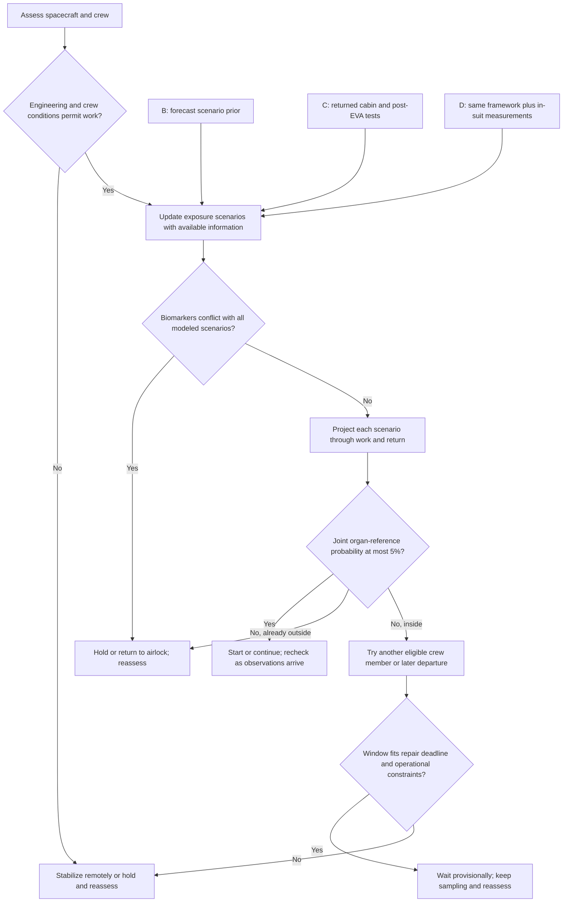

# How B, C and D decide

## Purpose and limits

One simulator runs all three strategies through the same emergency. The experiment asks whether different
information changes repair timing, crew choice and exposure. It does not try to make D win. NTP and NEP share the
solar radiation physics, keep their own engineering gates and repair priorities, and have hard repair deadlines
off by default. Without a separate deterioration model, waiting does not damage the spacecraft, so delayed-repair
results need that caveat. The model establishes no mission-success rate and no clinical benefit.

It supports one astronaut per EVA, sequential repairs, an explicit return trip after completion or abort, zero
starting exposure, and a mission interval of at most 30 days. Nonzero starting doses are rejected because their
exposure history and blood, skin and lens priors are not supplied. A constant GCR component applies in the cabin
and on EVA (see `background_radiation.md`). Reactor dose and earlier cruise exposure are excluded.

## Code map

| File | Job |
| --- | --- |
| `sim/informed_config.py` | Forecast, reference, cadence and noise settings |
| `sim/radiation_information.py` | Forecast integration, sample and result scheduling, immutable policy observations |
| `bayes_estimator/longitudinal.py` | History-dependent signals and the shared C/D Bayesian likelihood |
| `sim/strategies.py` | Common safety gates with separate crew selection and departure rules |
| `sim/mission_simulator.py` | The mission clock and the physical exposure accounting |
| `sim/run_comparison.py` | Paired B, C, D runs and output files |

## Decision rule

1. Honor stabilization, worksite clearance, consent, skills, repair prerequisites and operational restrictions.
2. For the highest-priority feasible repair, project each eligible astronaut's accumulated exposure through the
   return. B takes the first acceptable astronaut in rotation order. It estimates the current dose rate from the
   uncertain storm profiles, assumes that rate persists through the return, and rechecks as the clock advances. C
   ranks astronauts by their highest upper dose, as a fraction of each organ's own reference. D ranks by the larger
   of its biological estimate and the forecast estimate. Rotation breaks ties. For C and D, the unadjusted
   forecast and the biological estimate must both clear the launch gate.
3. D may wait up to four hours on a nonurgent task if the estimated dose score would drop by more than 20% and the
   remaining work still fits. This is an experimental scheduling assumption. When no acceptable EVA can start now,
   C and D search hourly departures over the next 24 hours, counting cabin exposure during the wait. B waits for
   a new current-rate assessment and never picks a future departure from the simulated storm. A candidate
   departure is provisional: the strategy waits, then recomputes at the next observation.
4. With no acceptable candidate, the crew shelters and the decision log flags a reassessment. Not finding a window
   inside the search horizon does not prove none exists later. No threshold override is allowed, and too little
   remaining forecast coverage requests temporary shelter.
5. During an EVA, the strategy rechecks accumulated plus remaining planned exposure. It aborts when the check
   fails, when measurements conflict with the forecast scenarios, or when the remaining EVA cannot be forecast.
6. Completed repairs alone do not authorize mission continuation. Engineering and current crew exposure must also
   permit it, and a hold or abandoned objective is not a prediction of crew death.

## Forecast and the shared gate

`ForecastSpec` is independent of the true `Scenario`. Its default is a 100-year, August-1972-shaped nominal
forecast with origin at profile hour 48, timing shifts of -6, 0 and +6 hours, and magnitude factors of 0.7, 1
and 1.3. The nine resulting histories get equal prior weights, which are experimental choices and not calibrated
forecast probabilities. The nominal forecast is fixed during a run. Later decisions re-evaluate it but never get
an update from the true storm. The Monte Carlo configs widen this to both historical shapes and 18 members.
Matching nominal and true templates is an idealized reference case, not a reconstruction of a real forecast, and
no zero-dose tail is invented beyond the data coverage.

Each member carries absorbed BFO dose in mGy and the original OLTARIS BFO, skin and lens dose in mGy-Eq, spread
over time with the same normalized timing as the environment, and each is one coherent past-and-future
exposure scenario. B keeps the equal prior. C and D reweight the scenarios from returned biological results, and
the same weights apply to that member's organ doses and its future. The assumption is that evidence about earlier
exposure helps tell persistent storm hypotheses apart. It is not a blood-to-skin conversion, a storm-peak
detector, or a validated way to predict spectral change. An incomplete scenario library can still produce
confidently wrong decisions.

The gate computes the weighted probability that any BFO, skin or lens reference is reached by the end of the
proposed EVA, counting prior dose, waiting and the return. Launch or continuation needs that probability at 5% or
less. This is one joint scenario risk, not three separate 95% checks. The references are 250, 1,500 and
1,000 mGy-Eq, and equal counts as reached. Marginal upper estimates are logged, but only the joint probability
decides. It is a conditional model probability, not clinically calibrated safety or NASA compliance. A gross
biomarker conflict still forces a hold or abort.

Biological likelihoods use absorbed BFO dose only. Scenario transport keeps the organ-specific Gray Equivalents,
and there is no universal mGy to mSv factor. No reference or noise coefficient was relaxed to favor C or D.

### Experiment modes

- **Shared current rate** (`shared_current_rate`, the primary experiment). B, C and D all estimate the current rate,
  assume it persists, and use the gate above. They differ only in evidence, crew choice and the rules in
  `monte_carlo.md`.
- **Ensemble projection** (`b_projection: ensemble`). Every strategy integrates the forecast ensemble's future. This
  is a sensitivity.
- **Matched current rate** (`matched_current_rate`). C and D follow B's rule, so returned results can only change
  the estimates behind the same gates. There are no dose-saving waits and no test-specific holds.
- **Stress tail.** `forecast_stress_weight` adds an extra forecast member at three times the largest in-range
  strength correction. The primary experiment sets it to 0.

## Collection and biological timing

C and D use the same estimator with different collection schedules and rules. Both get a six-hour cabin panel
(γ-H2AX and lymphocytes) starting with a baseline at hour 0, so they can learn while sheltered. The cadence, the
onboard capacity and the zero sampling burden are assumptions, not demonstrated instrument capability.

| Marker | C collection | D collection | Response used |
| --- | --- | --- | --- |
| γ-H2AX | Every 6 h in cabin and 0.5 h after return; result after 5 h | Same, plus before departure and hourly while outside; 1 h processing | Early foci response, 0.5 to 8 h decay |
| Lymphocytes | Every 6 h in cabin and 12, 24 and 48 h after return; 0.1 h processing | Same | 12 to 48 h response |
| 53BP1 | None | Before departure, hourly outside, 0.5 h after return; 1 h processing | 0.5 to 2 h early response |
| AEN | None | Hourly outside | 2 to 8 h |
| TRAF4 | None | Hourly outside | 4 to 8 h |
| DDB2 | None | Hourly outside | 4 to 8 h, retained through 24 h |
| TRIAP1 | None | Hourly outside | 8 to 24 h |
| FDXR | None | Hourly inside from mission hour 24 | 24 to 48 h, illustrative |

After an EVA, C and D keep that astronaut out of another EVA until a γ-H2AX result collected after the return is
back. A result that leaves risk above the criterion, or conflicts with the scenarios, keeps that person under
review. Other cleared astronauts may still work.

During D's EVA, each returned in-suit result enters the estimate at its result time. D checks exposure through an
immediate return and through planned completion plus return, and orders an early return if either check fails.
`in_eva_monitoring` turns this off to isolate its effect. The device and its timing are simulated. Biology
updates the estimate of exposure already received, and the forecast scenarios supply the projection through work
and return.

The response clock belongs to each earlier exposure interval, not to the EVA start or the result arrival. Every
marker integrates its age-response kernel against the full cabin and EVA dose history, so TRIAP1 measured during
a seven-hour EVA can inform older exposure without claiming to detect new exposure instantly. Inference uses sample
time, never result time, for the biological response.

Follow-ups due while outside wait until return, and the actual collection time is recorded. D's pre-departure
results enter before the launch decision and can change the crew choice or delay departure. A sample whose result
is still pending neither informs that departure nor forces a hold.

Lymphocyte processing takes 0.1 h in both C and D. C's γ-H2AX processing takes 5 h. D's γ-H2AX and 53BP1 processing
takes 1 h, an assumed automated turnaround for a 2040 imaging device. Both are configurable through
`lymphocyte_processing_delay_h` and `automated_foci_delay_h`, and explicit `instrument_delays_h` override them.
Other D markers have no processing delay. Result times are simulation boundaries, so a six-minute result does not
wait for the next hourly step. Hourly sampling approximates a continuous in-suit system and does not claim a real
instrument samples instantly. A configurable sampling burden delays cabin availability or pauses repair work while
outside exposure continues. Unavailable readings are logged, never invented. `operational_realism.md` covers
the instrument stress cases.

## Calibration and noise

The team slides give the AEN, TRAF4, DDB2 and TRIAP1 response windows and 2 Gy time-point anchors from Li et al.,
*Life* 2022;12:99. The code uses fold change above baseline divided by 2 Gy, with exploratory interpolation in
time and linear scaling in absorbed dose. That is not a demonstrated low-dose SPE-proton calibration. Kernel
values at uncovered times, the AEN early point and the DDB2 and TRIAP1 late points are read off slide plots.

γ-H2AX uses about 11 foci per Gy and a five-hour decay scale (Ivashkevich et al. 2011). 53BP1 borrows the same
early foci scale as a surrogate. Lymphocyte depletion coefficients are exploratory. FDXR has an illustrative
1 unit per Gy sensitivity and a 24 to 48 h window, since the slide gives a next-day signal and not a fitted curve. FDXR and
53BP1 need sensitivity tests or a real calibration before anyone makes a quantitative claim about D.

Other assumptions:

- BFO absorbed dose stands in for the sampled blood response. Nonuniform exposure, mixed radiation, individual
  biology and calibration transfer are not resolved.
- Positive signals carry log-normal noise: group log-SD 0.20, marker log-SD 0.20, reading log-SD 0.15. These
  values are experimental, not source-derived.
- Group and marker offsets persist for each astronaut, and gene and foci correlations are in the joint likelihood.
  Seeded draws give every strategy the same measurements, whatever else it requests.
- Only the latest returned sample per marker enters the likelihood, and the posterior is recomputed from the
  prior. This avoids false precision from treating repeats as independent, but it discards some longitudinal
  information.
- Grossly incompatible results (beyond three standard deviations of normalized Mahalanobis distance) keep the
  broad prior and flag a hold or abort. The finite ensemble cannot estimate a dose outside its support, and
  using matching kernels to generate and infer is an idealized setup, not external validation.
- Skin and lens checks can dominate in this lightly shielded scenario, so similar B, C and D decisions are a
  legitimate result. No policy or calibration was adjusted to force a D advantage.

Sources: https://www.mdpi.com/2075-1729/12/1/99, `bayes_estimator/markers.py`, the team slides, the OLTARIS
summaries, and the archived standard at
https://www.nasa.gov/wp-content/uploads/2023/11/nasa-std-3001-vol-1-rev-c-with-signature.pdf

## Running and checking

`python -B -m sim.run_comparison` runs one paired B, C, D comparison, and separate output folders keep separate
experiments. True outcomes are exported separately from policy estimates and measurement logs. `received_h` records
when a result reaches the decision system, and pending samples expose no values to policies. Observations are
immutable and carry no true dose, environment or crew objects.

The NEP access gate stays on: without a confirmed protected route and worksite, or an approved alternative, every
policy requests a hold. `--nep-protected-access` turns on the protected-access scenario for comparison. It is a
scenario assertion and is never inferred from the forecast.

## Decision flow

The diagram summarizes `strategies.py` and `radiation_information.py` and is not a separate implementation. A
hard engineering deadline can end the recovery attempt, but it never relaxes an exposure gate.

## After a radiation abort

A radiation abort registers the affected astronaut as a witness for a crew-wide restart review. Swapping in a
lower-dose astronaut does not erase what that witness showed about the shared storm. No true dose is used.

- Wait for the astronaut to return. C and D also need a returned post-return γ-H2AX sample, and a fast
  lymphocyte result cannot clear the review while that sample is pending.
- An unresolved conflict between any witness's biology and the scenarios blocks every later EVA until new results
  resolve it.
- For a candidate EVA, use the candidate's own accumulated and projected exposure with both the candidate's
  scenario weights and each witness's weights, and take the largest probability. Never transfer one astronaut's
  dose to another, and never multiply correlated likelihoods as if independent.
- Restart needs risk at 2.5% or less (`restart_risk_fraction` 0.5, half the normal 5%). Once outside, continuation
  uses the normal 5%. This hysteresis cuts launch and abort cycling near the boundary and is not a medical limit.
- Witness assessments last for the rest of the emergency and update as results arrive. A personal dose problem
  can allow a lower-dose replacement, but an unresolved shared forecast problem cannot.

With `retry_after_abort` and `restart_quiet_hours` set (the primary experiment), all three strategies share one
restart review. The common estimate must show two hours of improvement after the abort, the restart risk must stay
within the tighter 2.5% tolerance throughout, and the launch itself must pass the dose checks for the chosen
astronaut. A crew swap or a favorable lab result alone cannot reopen the task. The two hours are an assumption.
Without these settings the older rules apply. B and D follow the shared restart review, and C suspends the repair for
everyone until an independent radiation clearance arrives, which the model never provides, so that repair stays
suspended.

With `abort_progress_credit` at 1.0, an abort keeps the hours worked and a retry only finishes what remains. At the
default of 0, repairs are atomic seven-hour tasks and aborted work earns nothing, which penalizes strategies that
abort more. Partial progress is an assumption about the repair work and is not established for any real task.
